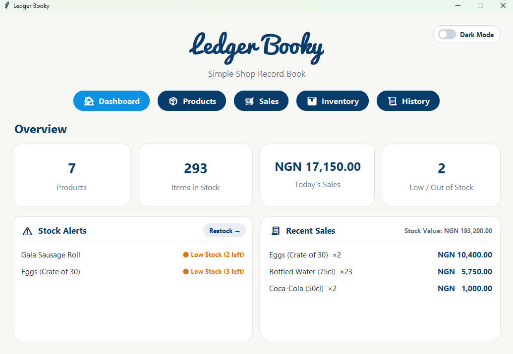
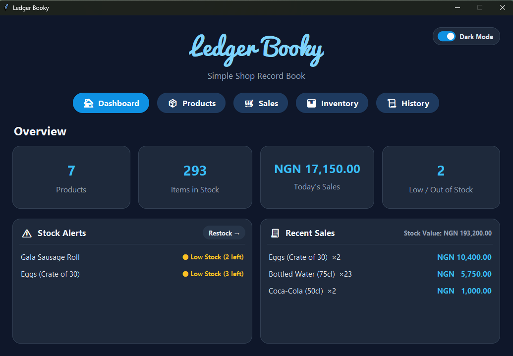
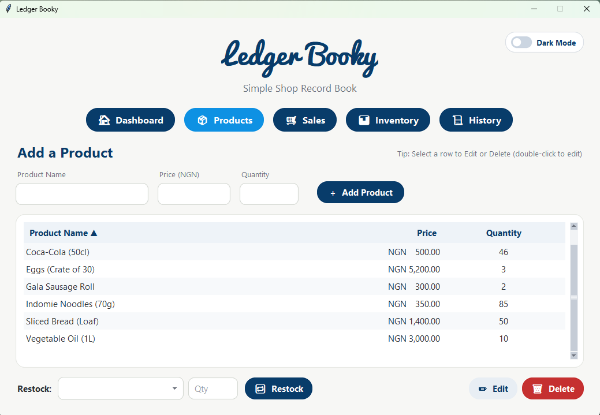
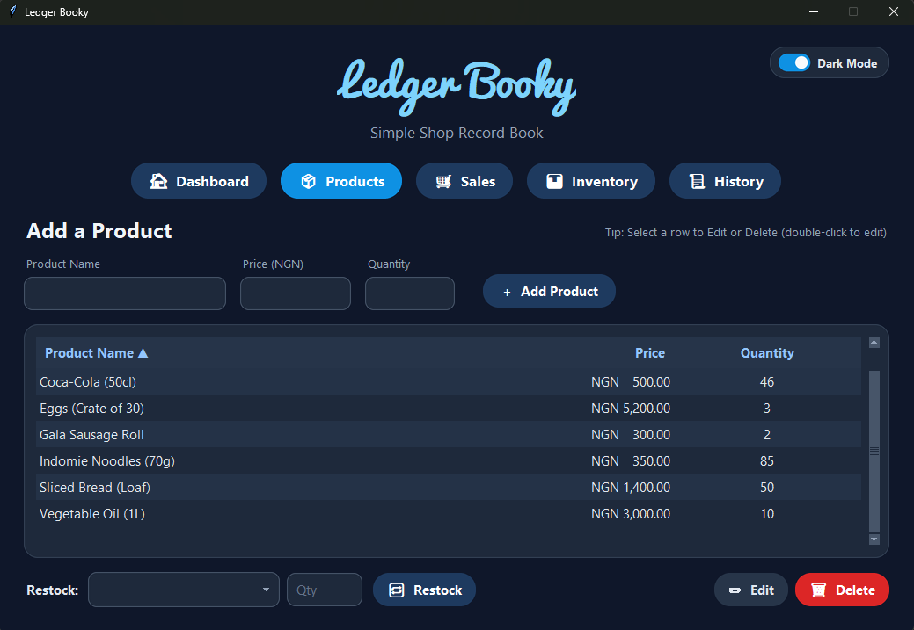
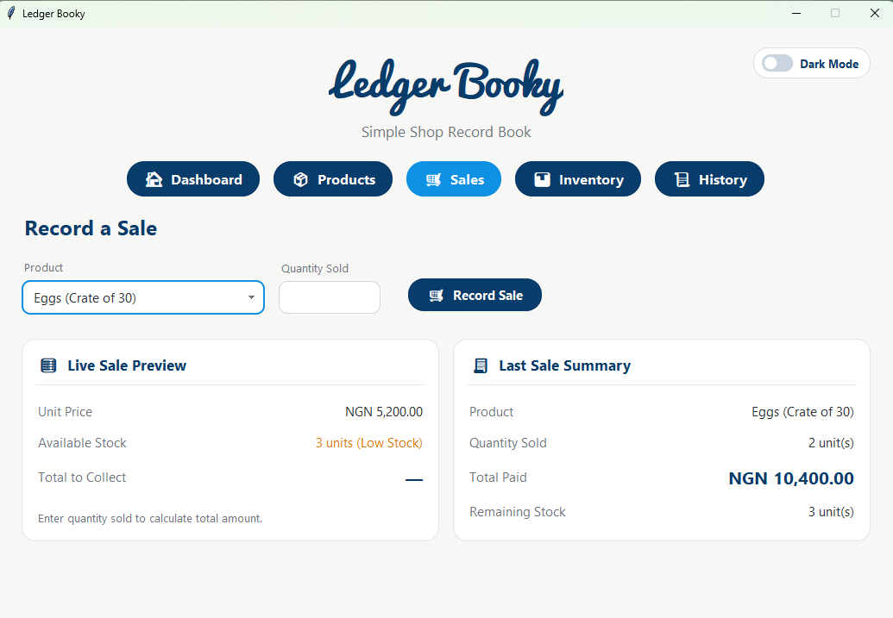
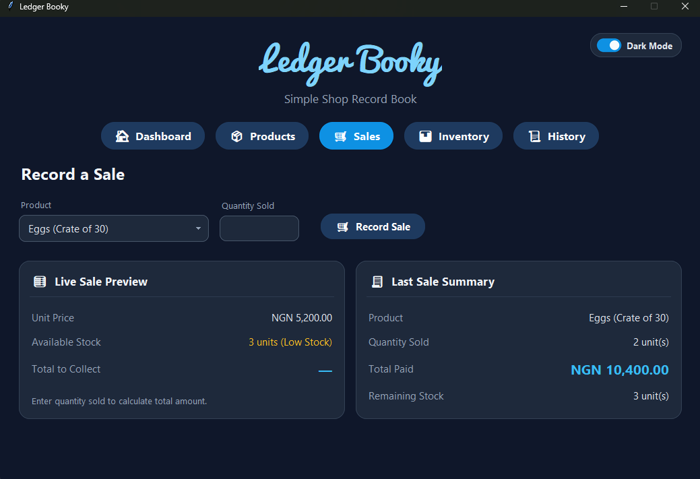
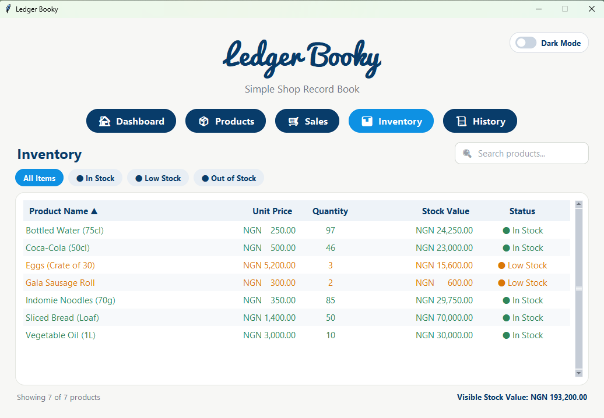
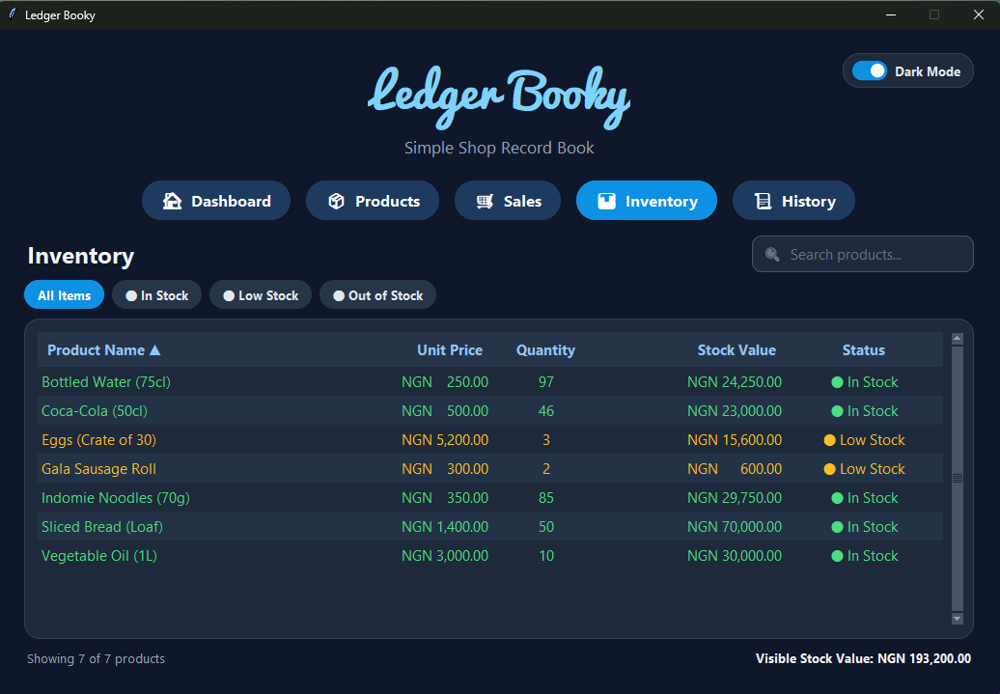
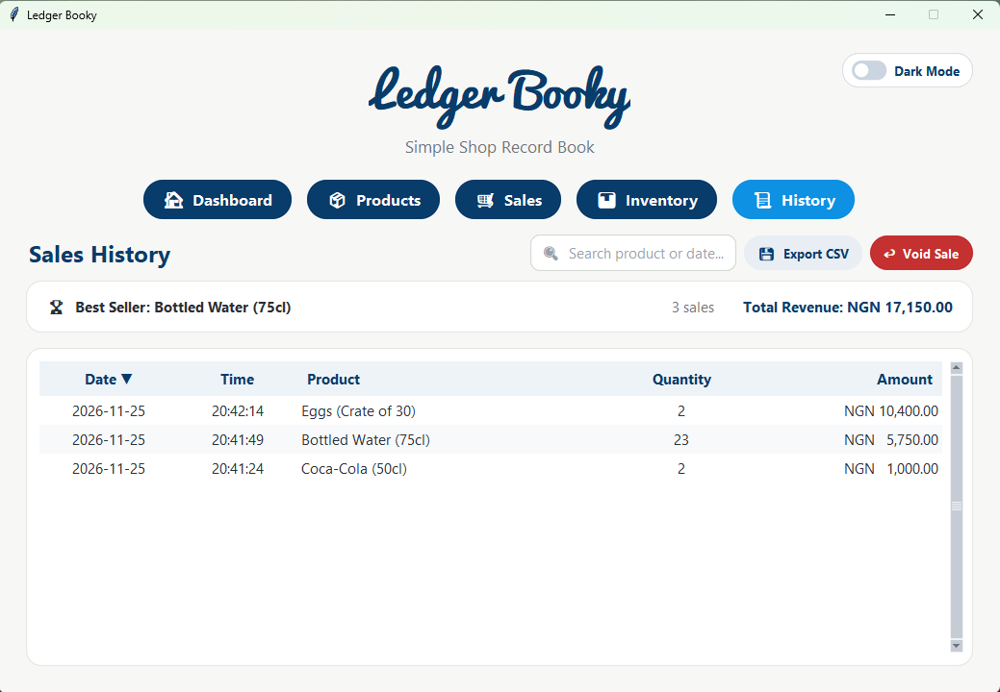
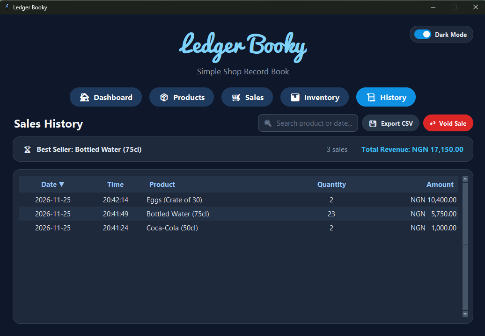

<div align="center">

# 📒 Ledger Booky

### A simple, offline shop record book for small traders

Track products, record sales, watch your stock, and review your history — all in one clean desktop app with Light and Dark modes.

*By **Dave Orus***

</div>

---

## Table of Contents

- [About](#about)
- [Features](#features)
- [Screenshots](#screenshots)
- [Getting Started](#getting-started)
- [Using the App](#using-the-app)
- [Project Structure](#project-structure)
- [How It Works](#how-it-works)
- [Data Files](#data-files)
- [Configuration](#configuration)
- [Validation Rules](#validation-rules)
- [Customising the App](#customising-the-app)
- [Troubleshooting](#troubleshooting)
- [Roadmap](#roadmap)
- [Author](#author)

---

## About

**Ledger Booky** is a desktop inventory and sales tracker built for small market traders and shop owners. It replaces the paper record book with a fast, friendly app that:

- works **fully offline** (no internet, no account, no database server),
- keeps your data in plain **CSV files** you can open in Excel or Google Sheets,
- saves **automatically** after every change, so nothing is lost,
- shows prices in **Nigerian Naira (NGN)** with accounting-style aligned columns.

It is written in pure Python using only the standard library. There is nothing to install apart from Python itself.

---

## Features

### 📊 Dashboard
- Four KPI cards: **Products**, **Items in Stock**, **Today's Sales**, and **Low / Out of Stock**.
- **Stock Alerts** panel listing the most urgent products (out of stock first, then lowest quantity) with a one-click **Restock →** shortcut.
- **Recent Sales** panel with the latest five sales and the **Total Stock Value** of your inventory.
- The Today's Sales number automatically shrinks its font so large amounts never overflow the card.

### 📦 Products
- **Add** a product with name, price, and quantity (press `Enter` to submit).
- **Edit** any product: select a row and click *Edit*, or simply **double-click** it.
- **Delete** a product with a confirmation prompt (or press the `Delete` key). Past sales history is kept.
- **Restock** any product from the bottom bar after a delivery.
- Click any column header to **sort** ascending or descending.

### 🛒 Sales
- Pick a product from an alphabetically sorted dropdown and enter the quantity sold.
- **Live Sale Preview** shows unit price, available stock, and the total to collect *before* you confirm, with colour-coded warnings if you try to sell more than you have.
- **Last Sale Summary** receipt card shows the product, quantity, total paid, and remaining stock.
- Overselling is blocked with a friendly message and **stock is left unchanged**.

### 🗃️ Inventory
- Full stock table with **Unit Price**, **Quantity**, **Stock Value**, and **Status**.
- **Live search** by product name.
- One-click **status filter pills**: All Items, In Stock, Low Stock, Out of Stock.
- Colour-coded status: 🟢 In Stock, 🟠 Low Stock, 🔴 Out of Stock.
- Footer shows how many products are visible and their combined stock value.
- Sortable by every column (including status urgency).

### 🧾 Sales History
- A log of every sale ever recorded, newest first by default.
- **Summary banner** with the **Best Seller**, sales count, and total revenue for the rows currently shown.
- **Live search** by product name or date (e.g. `2026-11-25`).
- **Void Sale**: remove a mistaken sale and automatically return the units to stock (if the product still exists).
- **Export CSV**: save an offline backup of your sales log to any location.
- Sortable by date, time, product, quantity, or amount.

### 🎨 Interface
- **Light and Dark mode** with a toggle switch; your choice is remembered between launches.
- Rounded cards, pill buttons, inputs, and dropdowns for a modern look.
- Pixel-aligned **NGN** amounts so the currency prefix and decimals line up in every table.
- Zebra-striped tables and themed scrollbars.
- On Windows, the title bar also follows the selected theme.

---

## Screenshots

Every page is available in both **Light** and **Dark** mode.

### Dashboard

| Light | Dark |
|---|---|
|  |  |

### Products

| Light | Dark |
|---|---|
|  |  |

### Sales

| Light | Dark |
|---|---|
|  |  |

### Inventory

| Light | Dark |
|---|---|
|  |  |

### Sales History

| Light | Dark |
|---|---|
|  |  |

---

## Getting Started

### Requirements

- **Python 3.10 or newer** (the code uses modern type hints such as `str | None`).
- **Tkinter**, which is bundled with Python on Windows and macOS.
  - On Linux (Debian/Ubuntu) you may need to install it:
    ```bash
    sudo apt install python3-tk
    ```

No third-party packages are required.

### Installation

```bash
# 1. Clone the repository
git clone https://github.com/davidorusjr/ledger-booky.git

# 2. Move into the project folder
cd ledger-booky

# 3. Run the app
python main.py
```

> On some systems the command is `python3 main.py`.

### First launch

- If `inventory.csv` or `sales.csv` do not exist, they are created automatically with the correct headers.
- Light mode is used by default until you switch themes.
- **Run the app from inside the project folder.** Data files are saved relative to the folder you launch from (see [Data Files](#data-files)).

### Optional: nicer title font

The app title uses the **Pacifico** cursive font. If it is not installed, Ledger Booky falls back to *Lucida Handwriting*, and then to a standard font. To get the intended look, install [Pacifico from Google Fonts](https://fonts.google.com/specimen/Pacifico).

---

## Using the App

The app is a single window with five pages, switched from the navigation bar at the top.

### Typical daily workflow

1. **Products → Add** your items once (name, price, opening quantity).
2. **Sales → Record Sale** each time you sell something.
3. **Dashboard** to check today's takings and any stock alerts.
4. **Products → Restock** when a delivery arrives.
5. **History → Export CSV** at the end of the week for a backup.

### Quick reference

| I want to… | Where | How |
|---|---|---|
| Add a new product | Products | Fill in the form and press **Add Product** or `Enter` |
| Change a price or name | Products | Select the row → **Edit** (or double-click), then **Save Changes** |
| Remove a product | Products | Select the row → **Delete** (or press `Delete`) |
| Add stock after a delivery | Products | Choose product, enter quantity, click **Restock** |
| Record a sale | Sales | Choose product, enter quantity, **Record Sale** or `Enter` |
| See what's running low | Dashboard / Inventory | Stock Alerts panel, or the *Low Stock* filter |
| Find a past sale | History | Search by product name or date |
| Undo a mistaken sale | History | Select the row → **Void Sale** |
| Back up my sales | History | **Export CSV** |
| Switch Light/Dark | Header | Use the theme toggle switch |

### Stock status rules

| Status | Condition | Colour |
|---|---|---|
| In Stock | quantity ≥ 5 | 🟢 Green |
| Low Stock | quantity between 1 and 4 | 🟠 Orange |
| Out of Stock | quantity = 0 | 🔴 Red |

The threshold of **5** is set by `LOW_STOCK_THRESHOLD` in `constants.py` and is easy to change.

---

## Project Structure

```
ledger-booky/
├── main.py          # Entry point – starts the app
├── constants.py     # Colours, fonts, sizes, file paths, business rules
├── models.py        # Product and Sale data classes
├── storage.py       # All reading/writing of CSV and settings files
├── utils.py         # Validation and currency formatting helpers
├── widgets.py       # Reusable rounded UI widgets
├── ui.py            # Main window, header, navigation, theming
├── dashboard.py     # Dashboard page
├── products.py      # Products page (add / edit / delete / restock)
├── sales.py         # Sales page (record sale + live preview)
├── inventory.py     # Inventory page (search / filter / sort)
├── history.py       # Sales History page (void / export)
├── inventory.csv    # Product data (auto-created)
├── sales.csv        # Sales log (auto-created)
├── settings.json    # Saved theme preference (auto-created)
└── README.md
```

| File | Purpose |
|---|---|
| `main.py` | Creates the `App` window and starts the Tkinter event loop. |
| `constants.py` | Single home for Light/Dark palettes, corner radii, fonts, spacing, file paths, CSV headers, the low-stock threshold, status labels, and page names. |
| `models.py` | `Product` and `Sale` dataclasses with small helpers (`total_value`, `is_out_of_stock`, `is_low_stock`). Holds data only; no file or UI code. |
| `storage.py` | `InventoryStore` and `SalesStore` plus theme preference load/save. The **only** module that touches files. |
| `utils.py` | `ValidationError`, the `validate_*` functions, and the `format_currency` helpers. |
| `widgets.py` | `RoundedCard`, `RoundedButton`, `RoundedEntry`, `RoundedCombobox`, and `ThemeToggle`. |
| `ui.py` | The `App` window: header, rounded navigation, content area, page switching, and Light/Dark theme application (including ttk styles). |
| `dashboard.py` | KPI cards, Stock Alerts, Recent Sales, Stock Value. |
| `products.py` | Product form, editing mode, delete, restock bar, sortable table. |
| `sales.py` | Record-sale form, Live Sale Preview, Last Sale Summary. |
| `inventory.py` | Search, status filters, sortable stock table, footer totals. |
| `history.py` | Searchable history, summary banner, void sale, CSV export. |

---

## How It Works

### Architecture

```
                ┌───────────┐
                │  main.py  │
                └─────┬─────┘
                      │ creates
                ┌─────▼─────┐
                │  App (ui) │──── owns ───┐
                └─────┬─────┘             │
        shows / refreshes pages           │
   ┌──────┬───────┬───┴───┬─────────┐     │
   ▼      ▼       ▼       ▼         ▼     ▼
Dashboard Products Sales Inventory History   InventoryStore  SalesStore
   └───────────── use ───────────────────────────►  (storage.py)
                                                        │
                                              inventory.csv / sales.csv
```

### Design principles

- **One window, five pages.** Pages are Tkinter `Frame`s stacked in the same area. `show_page()` in `ui.py` raises the chosen page and refreshes its data.
- **Single source of truth.** `InventoryStore` and `SalesStore` are created once in `App.__init__` and shared via `self.app.inventory_store` and `self.app.sales_store`.
- **Auto-save.** Every data-changing action (`add_product`, `update_product`, `delete_product`, `reduce_stock`, `restock_product`, `add_sale`, `delete_sale`) saves to disk immediately.
- **Storage is isolated.** Only `storage.py` opens data files, so switching to another backend (e.g. SQLite) would mean changing a single file.
- **Validation in one place.** Every form uses the same `utils.py` validators, so the rules are consistent everywhere.
- **Friendly errors.** Validation problems raise `ValidationError`, which pages catch and show in a message box instead of a traceback.
- **Central theming.** Colours live in `constants.py`. Each page implements `apply_theme()`, and `App.apply_theme()` updates every page when the toggle is switched.
- **Refresh after changes.** `App.refresh_all_pages()` keeps every page in sync after any add, edit, sale, void, or restock.

### Behaviour worth knowing

- **Selling** reduces stock and records the sale with the current date and time.
- **Voiding a sale** deletes the sale record and returns the units to stock, but only if the product still exists in inventory.
- **Deleting a product** does not delete its sales history.
- **Renaming a product** via Edit updates the inventory entry. Older sales keep the name used at the time of sale.
- **Best Seller** is the product with the highest *total quantity* sold (not revenue).
- **Today's Sales** sums every sale whose date matches today's date.
- Inventory is saved **alphabetically** by product name.

---

## Data Files

Ledger Booky stores everything in plain text files next to the app.

### `inventory.csv`

```csv
name,price,quantity
Golden Penny Spaghetti,1200.00,46
Indomie Chicken Super Pack,650.00,30
Semovita 1kg,1700.00,7
```

| Column | Type | Description |
|---|---|---|
| `name` | text | Product name (unique, case-insensitive) |
| `price` | decimal | Price per unit in NGN |
| `quantity` | integer | Units currently in stock |

### `sales.csv`

```csv
date,time,product,quantity,amount
2026-06-29,20:31:17,Semovita 1kg,2,3400.00
```

| Column | Type | Description |
|---|---|---|
| `date` | `YYYY-MM-DD` | Date of the sale |
| `time` | `HH:MM:SS` | Time of the sale |
| `product` | text | Name of the product sold |
| `quantity` | integer | Units sold |
| `amount` | decimal | Total paid (price × quantity at time of sale) |

### `settings.json`

```json
{
  "dark_mode": false
}
```

### Backups

- Use **History → Export CSV** for a dated copy of your sales (`ledgerbooky_sales_YYYY-MM-DD.csv`).
- To back up everything, copy `inventory.csv`, `sales.csv`, and `settings.json` to a safe place (USB drive, cloud folder, etc.).
- You can edit the CSVs in Excel, but **close the app first** and keep the header row and column order unchanged.

---

## Configuration

All settings live in `constants.py`.

| Setting | Default | What it does |
|---|---|---|
| `WINDOW_TITLE` | `"Ledger Booky"` | Window title |
| `WINDOW_WIDTH` / `WINDOW_HEIGHT` | `1040` / `690` | Starting window size |
| `LOW_STOCK_THRESHOLD` | `5` | Quantity below which a product counts as low stock |
| `INVENTORY_FILE_PATH` | `inventory.csv` | Where products are stored |
| `SALES_FILE_PATH` | `sales.csv` | Where sales are stored |
| `SETTINGS_FILE_PATH` | `settings.json` | Where the theme preference is stored |
| `LIGHT_THEME` / `DARK_THEME` | — | Full colour palettes |
| `RADIUS_*` | — | Corner roundness of cards, buttons, inputs |
| `FONT_FAMILY_TITLE` / `FONT_FAMILY_BODY` | `Pacifico` / `Segoe UI` | Fonts used |

---

## Validation Rules

| Field | Rule | Example message |
|---|---|---|
| Product name | Cannot be blank | *Please enter a product name.* |
| Product name | Must be unique (case-insensitive) | *"Semovita 1kg" already exists in inventory.* |
| Price | Must be a number; commas are allowed | *Price must be a number, e.g. 4500.* |
| Price | Cannot be negative | *Price cannot be negative.* |
| Quantity | Must be a whole number | *Quantity must be a whole number, e.g. 20.* |
| Quantity | Cannot be negative | *Quantity cannot be negative.* |
| Sale quantity | Must be greater than zero | *Please enter a quantity greater than zero.* |
| Sale quantity | Cannot exceed available stock | *Only 7 in stock. Sale not recorded.* |
| Restock quantity | Must be greater than zero | *Please enter a quantity greater than zero.* |

---

## Customising the App

- **Change the look:** edit the colours in `LIGHT_THEME` / `DARK_THEME`, or the radii and fonts in `constants.py`. Every page picks them up automatically.
- **Change the currency:** update `format_currency` and `format_currency_aligned` in `utils.py`, and the *Price (NGN)* label in `products.py`.
- **Change what counts as low stock:** edit `LOW_STOCK_THRESHOLD`.
- **Add a new page:** create a `Frame` class with `refresh()` and `apply_theme()`, add a page name in `constants.py`, and register it in `ui.py`.
- **Switch storage backend:** replace the logic inside `InventoryStore` and `SalesStore` in `storage.py`. No other file needs to change.

---

## Troubleshooting

| Problem | Solution |
|---|---|
| `ModuleNotFoundError: No module named 'tkinter'` | Install Tkinter: `sudo apt install python3-tk` (Linux). Reinstall Python with Tcl/Tk on macOS if needed. |
| `SyntaxError` on `str \| None` | You are using Python older than 3.10. Upgrade Python. |
| App opens with empty data | Run `python main.py` from **inside** the project folder so it finds your CSV files. |
| Title font looks different | Install the Pacifico font, or leave the automatic fallback. |
| Currency columns look slightly misaligned | Alignment is tuned for **Segoe UI** (Windows). Other platforms may differ slightly. |
| App crashes on start after editing a CSV | Check headers are exactly `name,price,quantity` and `date,time,product,quantity,amount`, and that numeric columns hold valid numbers. |
| Changes made in Excel don't appear | Close Excel, then restart Ledger Booky. The app reads files only at startup. |

---

## Roadmap

Ideas for future versions:

- [ ] Multi-currency or configurable currency symbol
- [ ] Date-range filters and daily/weekly/monthly sales reports
- [ ] Profit tracking (cost price vs. selling price)
- [ ] Customer and credit (debt) tracking
- [ ] Barcode scanning
- [ ] Printable receipts
- [ ] Import products from CSV
- [ ] Automated tests with `pytest`
- [ ] Packaged executable (`.exe`) using PyInstaller

---

## Author

**Dave Orus ;)**


---

<div align="center">

If you find Ledger Booky useful, consider giving the repository a ⭐

</div>
